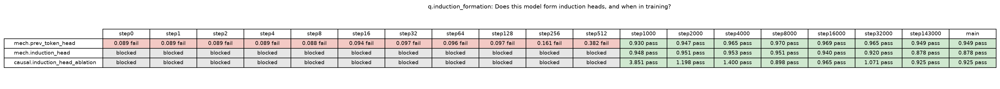

# claimci

A GO-style library of interpretability claims, where verification is a rerun.

Biology curates claims about genes with evidence codes, but its evidence is a wet-lab
experiment nobody reruns. In interpretability the experiment is code, so a claim can carry its
own test: the code, the data, the model and the threshold, stored as metadata, rerun on demand,
on new models, as the code changes. claimci is a small working version of that.

## What it does

**1. Given a paper, it extracts the claims, formulates experiments, and runs them on several
models, including ones the paper did not test.**
- `claimci ingest arXiv:2507.21509`: claims come from the abstract, and for each claim the
  paper's own tests (what was done, where, models, data, metric, stated numbers) come from the
  body. Every quote and number is string-checked against the paper. Claude Sonnet 5.5 extracts;
  nothing it says is trusted without the check.
- Matching picks an experiment template and fills its parameters from the paper's stated tests.
  For Persona Vectors it chose Qwen2.5-7B-Instruct, layer 20, the evil trait; for CAA,
  Llama-2-7b-chat, layer 13, sycophancy and corrigibility. Thresholds are fixed before any run.
- `claimci expand arXiv:2312.06681 --models Qwen/Qwen2.5-7B-Instruct,Qwen/Qwen3.5-4B`: the same
  experiments on other models, at the same relative depth. That choice is recorded as ours, and
  a failure there counts as scope, not as evidence against the paper.

**2. It stores the metadata (code, setup, everything) in local YAML**, plus an append-only JSONL
ledger of results, content-addressed artifacts (directions, judged answers) and a data manifest
that says where every file came from (the authors, elsewhere, or made here). Each claim
records which numbers the source stated and which were our choices (`supplemented`).
Trivially a service: the web app (`claimci serve`) already reads it live.

**3. It re-verifies from the metadata alone, skipping parsing.** `claimci verify` reruns
any claim; results are keyed by a hash of code, parameters, data, model and checkpoint, so
editing code or data makes a claim and its dependents stale, and a rerun of anything unchanged
is a cache hit. `claimci reverify` runs everything stale, previously verified claims first,
cheapest first. This is where compute goes to keep the knowledge current. Runs go to a GPU box
over SSH when one is configured.

**4. Downstream agents read semi-machine-readable results.** `claimci search`, `get`, `card`
and `explain`, all with `--json`, return verdicts with margins, the controls they passed,
caveats, whether the threshold was set after seeing results (post hoc), and the evidence type
(e.g. *Causal | Activation steering*). An agent can build on a result (claims depend on other
claims and consume their outputs, e.g. a direction or a head) and add new claims that run
through the same chain.

Not formal verification: a library with evidence codes, controls and provenance, closer to Gene
Ontology than to a proof checker. Next: run steps 1 and 3 in batch, which needs a modular,
scalable experiment layer (in the spirit of TransformerLens), and let the app write the
experiments it is missing, safely ([DESIGN.md](DESIGN.md) section 13).

## Tested on

| source | finding | model | result |
|---|---|---|---|
| Arditi et al. 2024, refusal direction (arXiv:2406.11717) | ablating the direction stops refusal; adding it induces refusal | gemma-2b-it (paper's) | **verified**: refusal 0.91 → 0.00 when ablated (random direction: 0.91); harmless prompts 0.00 → 1.00 when added (random: 0.00); our direction matches the authors' published one (cosine 0.99999); text loss −0.007 nats |
| @_lyraaaa_ on X: two neurons make Qwen evil | steering L14 N8949 / L13 N7956 makes Qwen3.5-4B evil | Qwen3.5-4B (post's) | **verified \***: 94% of answers judged misaligned (random neurons, same push: 8%; unsteered: 0%). \* loses coherence: 5% of steered answers coherent. Threshold set after seeing results (post hoc) |
| Chen et al. 2025, Persona Vectors (arXiv:2507.21509) | a persona vector steers the trait | Qwen2.5-7B-Instruct (paper's) | **verified \***: judged evil score 0.1 → 62 (random direction: −0.1); 148/200 contrast pairs confirmed by the judge. \* loses coherence at ×2: 0% coherent |
| | | gemma-2b-it (expansion) | **could not run**: Gemma will not adopt the evil persona (2/200 pairs pass), so there is no vector to extract |
| Panickssery et al. 2023, CAA (arXiv:2312.06681) | steering vectors shift behaviour both ways | Llama-2-7b-chat (paper's) | **not run**: gated, no access |
| | | Qwen2.5-7B-Instruct (expansion) | **does not transfer at ×1**: sycophancy +0.001 / −0.007, corrigibility +0.024 / −0.033 (threshold ±0.1) |
| | | Qwen3.5-4B (expansion) | **partly**: corrigibility +0.12 ✓ / −0.03, sycophancy ±0.01 |
| Olsson et al. 2022, induction heads | induction heads form abruptly early in training | pythia-160m, 19 checkpoints | **verified**: forms between step512 and step1000 (score 0.09 → 0.95); ablation +0.85 nats |
| Betley et al. 2025, Emergent Misalignment (arXiv:2502.17424) | fine-tuning on insecure code causes broad misalignment | — | **gap**: needs fine-tuning, which the library does not have yet (the first target for self-written experiments) |

Every row opens in the web app to the evidence: the quote, the authors' own tests, our
verifications with thresholds and who set them, controls, and judged samples you can read.

```
claimci serve            # http://127.0.0.1:8765
```

Specs: [SPEC.md](SPEC.md) (claim format, evidence codes, lifecycle) and
[RUNNER.md](RUNNER.md) (pipeline, planner, backend, invalidation).
[DESIGN.md](DESIGN.md) is where this is going: findings vs verifications vs readouts, objects
vs annotations vs mechanisms, the agent read path, the nightly refresh, local-first
verification with a shared base, and V2 (the app writes its own experiments).
[PENDING.md](PENDING.md) records the first real-weight verification.

## Borrowed from biology

The mapping from Gene Ontology to interp can be:

| Gene Ontology | claimci |
|---|---|
| Gene product (a protein, an RNA) | Model component (a head, a layer, a direction, a neuron) |
| GO term (a function, process or location) | Statement (what the component does, with a metric and threshold) |
| Annotation: gene product × term × evidence | Claim file: subject × statement × evidence |

## Evidence codes

| Code | Name | Rerunnable | Can be a dependency |
|---|---|---|---|
| NAS | Non-traceable author statement (claim from a paper, no section cited) | no | no |
| TAS | Traceable author statement (paper + section/figure cited) | no | no |
| IEA | Inferred from automated annotation (auto-interp label, no experiment) | yes | no |
| IOB | Inferred from observation (reads activations/attention, no fit, no intervention) | yes | yes |
| ICP | Inferred from correlational probe (fit on activations, held-out eval) | yes | yes, not for causal claims |
| IMP | Inferred from mutant phenotype (ablation / patching, behavior change measured) | yes | yes |
| ISS | Inferred from steering (add direction/feature, predicted behavior appears) | yes | yes |
| ICA | Inferred from causal abstraction (interchange intervention vs stated high-level model) | yes | yes |

The ontology lives in [claimci/schema/evidence.yaml](claimci/schema/evidence.yaml).

## Install

Python 3.11+. On CPU-only machines, install the CPU torch wheel first so pip
doesn't pull the CUDA build:

```
git clone https://github.com/tumanian/interp_claim_lib && cd interp_claim_lib
python -m venv .venv && . .venv/bin/activate
pip install torch --index-url https://download.pytorch.org/whl/cpu   # optional, CPU-only
pip install -e '.[report,test,ingest]'
claimci validate && claimci plan --revisions main
```

`validate` and `plan` never load a model.

## Commands

```
claimci ingest arXiv:2507.21509                   # findings from the abstract, the paper's tests from the body; matched to templates
claimci ingest https://transformer-circuits.pub/...   # a blog or web page (TL;DR / summary section first)
claimci ingest https://x.com/... --text-file post.txt   # a post that cannot be fetched: its URL and its text
claimci match arXiv:2312.06681                    # re-match an ingested source (no re-extraction)
claimci expand arXiv:2312.06681 --models Qwen/Qwen2.5-7B-Instruct,Qwen/Qwen3.5-4B
claimci validate                                  # typing rules, provenance, DAG, dataset hashes; no model loads
claimci plan --claims ID,ID                       # groups, forward passes, ledger hits; no model loads
claimci verify --claims ID,ID                     # run; results to ledger/results.jsonl
claimci reverify [--dry-run]                      # everything stale, previously-verified first, cheapest first
claimci search "refusal direction" [--json]       # find claims
claimci get CLAIM                                 # one result as JSON: verdict, value, margin, controls, caveats
claimci card CLAIM | claimci explain arXiv:ID     # cards, text or --json
claimci judge answers.jsonl                       # the LLM judge as a tool (Claude Haiku 5.5 by default)
claimci serve                                     # the web app
```

Reports for the Pythia run: `claimci matrix --question q.induction_formation --png matrix.png`,
`claimci throughput`, `claimci status`. Remote runs: put
`{"host": "user@ip", "key": "~/.ssh/key.pem", "dir": "~/interp_claim_lib"}` in
`.claimci-remote.json`; `verify` and the web app then run on that box and merge its ledger back.
Ingest and the judge need `ANTHROPIC_API_KEY`.

## Results: pythia-160m across training

Run on an 8-core Apple Silicon Mac (CPU, torch 2.14.1, transformers 5.21.0),
checkpoints pre-downloaded. `scripts/step8.sh` reproduces the eight-checkpoint
run; the early checkpoints (step1..step512) and `main` were added with
`claimci verify --revisions ...`.



| claim | evidence | step0 | step1 | step2 | step4 | step8 | step16 | step32 | step64 | step128 | step256 | step512 | step1000 | step2000 | step4000 | step8000 | step16000 | step32000 | step143000 | main |
|---|---|---|---|---|---|---|---|---|---|---|---|---|---|---|---|---|---|---|---|---|
| mech.prev_token_head | IOB | 0.089 ✗ | 0.089 ✗ | 0.089 ✗ | 0.089 ✗ | 0.088 ✗ | 0.094 ✗ | 0.097 ✗ | 0.096 ✗ | 0.097 ✗ | 0.161 ✗ | 0.382 ✗ | 0.930 ✓ | 0.947 ✓ | 0.965 ✓ | 0.970 ✓ | 0.969 ✓ | 0.965 ✓ | 0.949 ✓ | 0.949 ✓ |
| mech.induction_head | IOB | blocked | blocked | blocked | blocked | blocked | blocked | blocked | blocked | blocked | blocked | blocked | 0.948 ✓ | 0.951 ✓ | 0.953 ✓ | 0.951 ✓ | 0.940 ✓ | 0.920 ✓ | 0.878 ✓ | 0.878 ✓ |
| causal.induction_head_ablation | IMP | blocked | blocked | blocked | blocked | blocked | blocked | blocked | blocked | blocked | blocked | blocked | 3.851 ✓ | 1.198 ✓ | 1.400 ✓ | 0.898 ✓ | 0.965 ✓ | 1.071 ✓ | 0.925 ✓ | 0.925 ✓ |

Thresholds: the paper reports no thresholds for Pythia, so every `expect`
here is ours (set in PROMPT.md) and recorded under
`provenance.supplemented.expect` in each claim file. All three claims were
promoted to `verified` at their subject revision (`main`) with
`basis: supplemented_expect`, meaning they hold under our thresholds, not that
a number from the paper was reproduced.

Onset: the induction head forms between step512 and step1000 (about 1-2B
tokens). With the dependency gate removed in a throwaway copy, so the
blocked cells have values, the induction score is 0.04-0.09 from step0 through
step512 and 0.948 at step1000; the ablation loss delta goes from 0.007 to
3.85 nats. The previous-token head rises a little earlier (0.161 at step256,
0.382 at step512). Bound heads: previous-token L3H2 at every trained
checkpoint; induction L4H10 at step1000, L4H6 from step2000 on.

Throughput (eight-checkpoint run):

| mode | claims verified | forward passes | seconds | claims/minute |
|---|---|---|---|---|
| shared | 22 | 15 | 24.2 | 54.6 |
| naive | 22 | 29 | 33.6 | 39.2 |

Forward passes naive/shared: 1.93x.

## Layout

```
claimci/
  schema/       what a claim is: types, loading, validation, experiment registry, behaviour hash
  store/        what has been recorded: results ledger (and gating), artifacts, vendored data
  run/          how claims run: plan, runner, verify, backends, executors, formats, operations,
                interventions, readouts
  experiments/  the experiment library, registered by id
  sources/      papers and posts in: arXiv / web / post adapters, extraction, matching, templates,
                expansion to other models
  read/         reading results: report cards, matrix, objects, agent API, judge tool
  app/          the local web app
  cli.py
```

Imports point one way (schema <- store <- run <- experiments; sources and read on top; app and
cli above everything), checked by tests/test_layout.py. Claim keys do not depend on this layout.

## Tests

```
pytest
```

88 tests. Tests never download and never call an API (the judge is stubbed). What needs real
weights skips until they are in the HF cache: `EleutherAI/pythia-70m` (`main`, `step0`) for the
induction checks, `Qwen/Qwen2.5-0.5B-Instruct` for end-to-end runs of the steering experiments
through `verify` (CAA and Persona Vectors: direction, steering, random control, artifacts, ledger
cache, hook cleanup). Everything else runs on a random-init model with Pythia's architecture,
built locally, or on no model at all (schema, validation, ingest checks, templates, matching,
expansion, reports, search, re-verification order).
